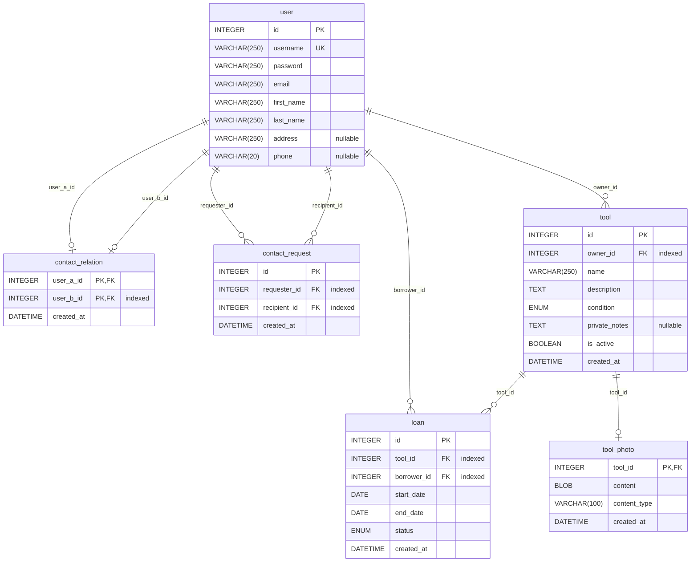

# Schéma de données

Diagramme entité-relation généré depuis les modèles SQLAlchemy de `application/models/` par
[paracelsus](https://github.com/tedivm/paracelsus) (ADR 0009). Ne pas l'éditer à la main :
depuis `application/`, `uv run paracelsus inject ../docs/schema.md` le régénère, et `/verifier`
échoue s'il n'est plus à jour. Les règles d'évolution du schéma sont dans l'ADR 0007.

<!-- BEGIN_SQLALCHEMY_DOCS -->

<!-- END_SQLALCHEMY_DOCS -->
